  

  
  

## About me

I’m a second-year **BSc. IT student specializing in Artificial Intelligence** at **Maulana Abul Kalam Azad University of Technology (MAKAUT), West Bengal**. I enjoy exploring the intersection of AI, software, and visual design—turning ideas into useful, thoughtful experiences.

- **Community:** Core Team Member at GDGoC MAKAUT; Google Cloud Study Jam 2025 Supervisor
- **Interests:** Artificial Intelligence, Python development, UI/UX, graphic design, creative development, and video editing
- **Currently learning:** Python, Java, and Artificial Intelligence
- **Ask me about:** Python, C, C++, UI/UX design, and creative development
- **Fun fact:** I design interfaces by day, explore AI by night, and occasionally build Minecraft worlds in between. 🚀

## Connect

  
  
  
  
  
  
  

## Tech stack & tools

  
  
  
  

  
  
  
  

## Currently working on

- Building a stronger foundation in Python and Java
- Exploring Artificial Intelligence concepts and applications
- Improving my UI/UX and visual design skills
- Developing creative projects that combine technology and design

## Featured projects

I haven’t confirmed which repositories you want featured yet. Add your selected projects here using this format—replace these prompts with links to real repositories:

- **Project name** — One-line description · [View repository](https://github.com/pranab2403/REPLACE_WITH_REPOSITORY)
- **Project name** — One-line description · [View repository](https://github.com/pranab2403/REPLACE_WITH_REPOSITORY)

## GitHub at a glance

  
  

  

  <a href="https://github.com/pranab2403?tab=repositories">Browse my repositories →</a>

## Trophies

  

## Profile views

  

<em>“Code. Learn. Build. Repeat.”</em>

  

